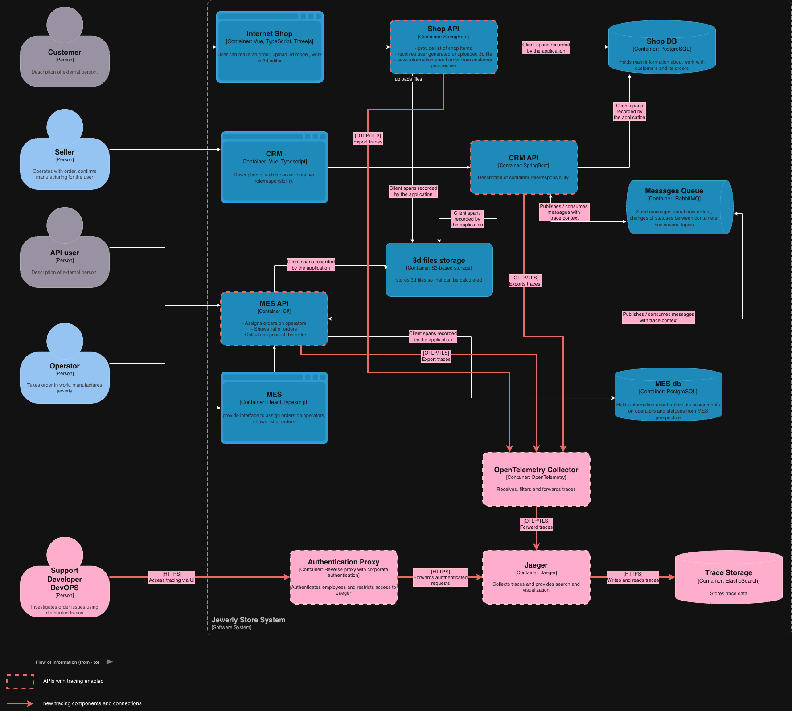

# Задание 3. Архитектурное решение по трейсингу

## 1. Системы и операции для трейсинга

Заказ проходит через магазин, CRM и MES. Между CRM и MES сообщения передаются через RabbitMQ. У партнерских заказов другая точка входа - MES API. Трейсинг должен покрывать оба сценария и связывать действия разных приложений.

| Система или взаимодействие     | Какие операции покрываем                                                                                                                         | Где заказ может задержаться или обработаться с ошибкой                                                           |
| ------------------------------ | ------------------------------------------------------------------------------------------------------------------------------------------------ | ---------------------------------------------------------------------------------------------------------------- |
| Shop API                       | Создание и отправка заказа, загрузка 3D-модели, сохранение данных в Shop DB                                                                      | Заказ не сохранился, файл не загрузился, запрос к БД выполняется долго                                           |
| CRM API                        | Создание заказа по сообщению от MES, согласование производства, изменение и закрытие заказа, обращения к Shop DB                                 | Сообщение получено, но заказ не создан, статус не изменился или не сохранился                                    |
| MES API                        | Прием заказа партнера, расчет стоимости, получение списка заказов, назначение оператора, изменение производственных статусов, обращения к MES DB | Расчет завис или завершился ошибкой, список загружается медленно, заказ не назначается оператору                 |
| Обмен CRM и MES через RabbitMQ | Публикация события, получение подтверждения от брокера, начало и результат обработки сообщения, подтверждение обработки или отклонение           | Событие не опубликовано, долго ожидает обработки, обработчик завершился с ошибкой или получил сообщение повторно |
| Обращения к Shop DB и MES DB   | Выполнение запросов и транзакций со стороны приложений                                                                                           | Медленный запрос, ошибка соединения или сохранения данных                                                        |
| Обращения к S3-хранилищу       | Загрузка и чтение 3D-модели из Shop API, CRM API и MES API                                                                                       | Файл недоступен, чтение занимает много времени, расчет не может получить модель                                  |

В первую очередь подключаем MES и CRM вместе с обменом сообщениями: этот участок участвует в обоих каналах заказов. Затем подключаем Shop API. Обращения к БД, RabbitMQ и S3 фиксируем на стороне приложений. Устанавливать средства трейсинга внутрь управляемой БД или S3 не требуется. Фронтенды в первый этап не включаем: для поиска задержек между системами начинаем трейс с входящего запроса в API. Если проблема окажется в работе браузера, необходимо провести отдельное исследование.

### Данные, которые должны попадать в трейсинг

| Данные | Для чего нужны |
|---|---|
| `trace_id`, `span_id`, идентификатор родительской операции или ссылка на связанную операцию | Связывать действия внутри одного приложения и между системами |
| Название сервиса, экземпляр, окружение и версия приложения | Определять, где выполнялась операция и с какой версией кода |
| Название операции, время начала и окончания, длительность, результат | Находить медленные и неудачные участки |
| `order_id` и канал поступления заказа | Искать операции конкретного заказа и отличать магазин от партнерского API |
| Предыдущий и новый статус заказа, результат сохранения | Видеть, какой переход выполнялся и был ли он успешно записан |
| HTTP-метод, шаблон маршрута и код ответа | Определять проблемный запрос без сохранения полного URL с параметрами |
| Идентификатор события, тип сообщения, exchange, очередь, время публикации, признак повторной доставки и номер попытки, если он учитывается приложением | Сопоставлять отправку и обработку события, разбирать повторы и ожидание |
| Название БД, тип операции и длительность обращения | Отличать задержку приложения от задержки при работе с данными |
| Тип обращения к S3, внутренний идентификатор модели, размер файла и число полигонов для расчета | Проверять связь времени загрузки и расчета со сложностью модели |
| Категория ошибки и очищенное описание | Понимать причину сбоя без записи секретов и персональных данных |

`order_id` добавляем после присвоения идентификатора заказу. Список заказов относится сразу к нескольким заказам, поэтому в такой span не записываем весь список идентификаторов. Полные SQL-запросы с параметрами, тела сообщений и содержимое 3D-файлов не собираем.

## 2. Мотивация

Сейчас заказы могут находиться в непонятном состоянии, а задержка затрагивает несколько систем. По отдельной ошибке API сложно понять, была ли она причиной проблемы или следствием сбоя в другом приложении.

Трейсинг позволит проследить обработку заказа: какой сервис принял запрос, какие данные запросил, какое событие отправил и что произошло у получателя. Команда сможет быстрее находить последний успешный шаг и проверять гипотезы о причинах задержек.

| Показатель, на который может повлиять внедрение | Какой результат ожидаем                                                                      |
| ----------------------------------------------- | -------------------------------------------------------------------------------------------- |
| Среднее время поиска причины инцидента          | Сократится за счет связанной истории операций вместо раздельного поиска по приложениям       |
| Среднее время восстановления обработки заказа   | Сократится, поскольку будет проще определить неудачный этап и выбрать способ восстановления  |
| Время ответа списка заказов MES                 | Может снизиться после исправления медленных запросов и операций, найденных с помощью трейсов |
| Число заказов с превышенным временем в статусе  | Может снизиться после устранения обнаруженных сбоев и задержек передачи событий              |
| Доля заказов, выполненных в обещанный срок      | Может вырасти после исправления причин задержек                                              |

Трейсинг помогает найти причины, но улучшение времени ответа и выполнения заказов требует исправлений. Показатели сравниваем до и после этих изменений, для заказов используем бизнес-метрики из Task2.

## 3. Предлагаемое решение

### Компоненты

Используем OpenTelemetry для создания и передачи трейсов, OpenTelemetry Collector для их приема и обработки и Jaeger для поиска и просмотра. Трейсы Jaeger сохраняет в отдельном Elasticsearch, чтобы не увеличивать нагрузку на рабочие БД магазина и MES.

| Компонент                        | Что нужно внедрить или изменить                                                                                                                       |
| -------------------------------- | ----------------------------------------------------------------------------------------------------------------------------------------------------- |
| Shop API и CRM API               | Подключить OpenTelemetry Java Agent для стандартных HTTP-операций и обращений к БД. Добавить свои spans для бизнес-операций и необходимые поля заказа |
| MES API                          | Подключить OpenTelemetry SDK для .NET и инструментацию HTTP и БД. Добавить spans расчета стоимости, назначения оператора и изменения статусов         |
| Обработчики RabbitMQ в CRM и MES | Передавать контекст трейсинга в заголовках сообщений и восстанавливать его у получателя                                                               |
| OpenTelemetry Collector          | Принимать spans по OTLP, удалять запрещенные поля и отправлять данные в Jaeger пакетами                                                               |
| Jaeger                           | Принимать трейсы от Collector, записывать их в хранилище и предоставлять интерфейс поиска по сервису, времени и `order_id`                            |
| Elasticsearch                    | Хранить данные трейсов отдельно от Shop DB и MES DB                                                                                                   |
| Прокси доступа к Jaeger          | Проверять учетную запись и разрешенную роль перед доступом к интерфейсу и API поиска                                                                  |

### Как связываются операции

1. При входящем запросе в Shop API или MES API создается контекст трейсинга. Для внутренних HTTP-вызовов он передается в заголовках `traceparent` и при необходимости `tracestate`.
2. Приложение создает дочерние spans для обращения к БД, S3 и выполнения бизнес-операций. После создания заказа добавляет `order_id`.
3. При публикации в RabbitMQ приложение помещает контекст в заголовки сообщения. Идентификаторы заказа и события передаются вместе с событием.
4. Получатель извлекает контекст и связывает обработку с публикацией. Отдельно отмечает сохранение результата и подтверждение или отклонение сообщения. Повторная попытка получает отдельный span с тем же идентификатором события.
5. Приложения отправляют spans в Collector, затем они попадают в Jaeger и Elasticsearch. Сотрудник находит операции по `order_id` и видит длительность и результат каждого шага.

### Схема

## 4. Компромиссы

| Ограничение                                  | Что это означает для решения                                                                                                                                                                                              |
| -------------------------------------------- | ------------------------------------------------------------------------------------------------------------------------------------------------------------------------------------------------------------------------- |
| Дополнительная нагрузка и стоимость хранения | Создание spans, передача и хранение требуют ресурсов. Собираем операции заказа и зависимости, без содержимого файлов и подробного трейсинга каждой внутренней функции.                                                    |
| MES потребует доработок                      | Исходный код доступен, поэтому можно добавить инструментацию. Но бизнес-операции и обработчики сообщений не обязательно будут покрыты автоматически, на них потребуется время C#-разработчика.                            |
| Неполное покрытие                            | До подключения всех API и обработчиков цепочка будет иметь разрывы. Внутреннюю работу управляемых БД и S3 не увидим, только длительность и результат обращения со стороны приложения.                                     |
| Длительные операции и действия людей         | Обычный span отправляется после завершения. Для зависшего расчета будет видно начало, но не итог. Ожидание согласования или работы оператора оцениваем по статусам заказа и метрикам, а не по одному непрерывному трейсу. |
| Трейсинг не гарантирует доставку сообщений   | Он помогает найти проблемный участок, но подтверждения, безопасные повторы и восстановление заказов реализуются отдельно в рамках инициативы надежности из Task1.                                                         |
| Сбой системы трейсинга или выборочный сбор   | Часть spans может отсутствовать. Передача выполняется асинхронно с ограниченным буфером, недоступность Collector не должна останавливать прием и обработку заказов.                                                       |
| Внешние системы                              | Без инструментации партнера или транспортной компании их внутренние операции недоступны. Покрываем собственную точку входа и обработку полученного запроса или сообщения.                                                 |

## 5. Безопасность

- **Доступ сотрудников.** Jaeger доступен через прокси с корпоративной аутентификацией. Просмотр разрешен сотрудникам с актуальной учетной записью и ролью поддержки, разработчика или DevOps. Настройка инфраструктуры доступна только администраторам. Прямой доступ к Jaeger в обход прокси закрыт.
- **Доступ из сети.** Collector, Jaeger и Elasticsearch находятся во внутренней сети. Приложения могут отправлять данные в Collector, Collector - в Jaeger, а Jaeger - обращаться к хранилищу. Клиентам магазина и партнерам доступ к системе трейсинга не предоставляется.
- **Защита передачи.** Используем TLS. Для отправки в Collector сервисы проходят проверку по сертификату или служебным учетным данным. Учетные данные хранилища доступны только нужным компонентам и не хранятся в исходном коде.
- **Состав данных.** Не записываем ФИО, адреса, телефоны, токены, cookies, тела запросов и сообщений, содержимое моделей и подписанные ссылки на файлы. Ошибки очищаем от таких данных. В Collector дополнительно удаляем запрещенные атрибуты.
- **Внешний контекст.** Заголовки от партнеров не используем для авторизации или определения владельца заказа. На публичной границе создаем собственный контекст, чтобы внешний запрос не мог подменить внутреннюю цепочку или управлять объемом сбора. Канал и идентификатор заказа определяет приложение.
