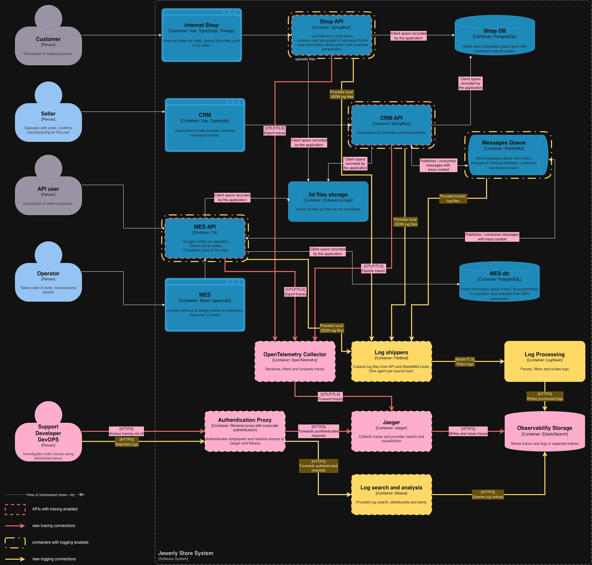

# Задание 4. Архитектурное решение по логированию

## 1. Источники и состав логов

| Система                        | Какие события логируем на уровне INFO                                                                                                                 | Для чего                                                                 |
| ------------------------------ | ----------------------------------------------------------------------------------------------------------------------------------------------------- | ------------------------------------------------------------------------ |
| Shop API                       | Создание и отправка заказа, загрузка модели, успешное сохранение данных.                                                                              | Восстановить действия покупателя и проверить, принят ли заказ.           |
| CRM API                        | Создание заказа по событию MES, согласование производства, изменение статуса и закрытие заказа.                                                       | Проверить обработку заказа продавцом и переходы между этапами.           |
| MES API                        | Прием партнерского заказа, начало и завершение расчета, назначение оператора, изменение производственных статусов и отправка заказа.                  | Найти незавершенный расчет или этап, на котором остановилась работа.     |
| Обмен CRM и MES через RabbitMQ | Публикация с подтверждением брокера, получение и успешная обработка сообщения, подтверждение обработки, безопасный пропуск уже обработанного события. | Сопоставить отправку с обработкой и отличить повтор от нового события.   |
| Все API                        | Завершение HTTP-запроса, успешная загрузка и чтение модели из S3, запуск и штатная остановка приложения.                                              | Проверить результаты запросов, доступ к модели и перезапуски приложений. |
| RabbitMQ                       | Запуск и штатная остановка брокера, открытие и закрытие соединений.                                                                                   | Найти изменения в работе брокера.                                        |

Приложения пишут JSON: время в UTC, уровень, сервис, экземпляр, окружение, версия, название события и результат. Для заказа добавляем `order_id` и канал поступления, для запроса - `request_id`, для связи с трейсингом - `trace_id` и `span_id`, если они доступны.

### Необходимые события уровня INFO

| Система           | Событие                                                    | Дополнительные данные                                                                                                                       |
| ----------------- | ---------------------------------------------------------- | ------------------------------------------------------------------------------------------------------------------------------------------- |
| Все API           | Завершение HTTP-запроса                                    | Шаблон маршрута, метод, код ответа, длительность. Регулярные запросы healthcheck исключаем.                                                 |
| Все API           | Запуск и штатная остановка приложения                      | Версия, экземпляр и причина остановки (если известна).                                                                                      |
| Все API           | Успешная загрузка или получение 3D-модели                  | Внутренний идентификатор модели, тип операции, размер файла, длительность.                                                                  |
| Shop API          | Создание заказа и отправка на обработку                    | Внутренний идентификатор покупателя, статус заказа, результат сохранения. Создание корзины и отправку заказа различаем по названию события. |
| CRM API           | Создание заказа по событию MES и согласование производства | Идентификатор исходного события, результат сохранения, внутренний идентификатор сотрудника для ручного действия.                            |
| CRM API           | Закрытие заказа                                            | Предыдущий и новый статус, источник подтверждения (транспортная компания или сотрудник).                                                    |
| MES API           | Принятие партнерского заказа                               | Идентификатор партнера, присвоенный идентификатор заказа, результат принятия.                                                               |
| MES API           | Начало и завершение расчета стоимости                      | Идентификатор модели, число полигонов, длительность и результат расчета. Начало фиксируем отдельно, чтобы видеть незавершенные расчеты.     |
| MES API           | Назначение заказа оператору                                | Внутренний идентификатор оператора, результат назначения.                                                                                   |
| MES API           | Отправка заказа покупателю                                 | Статус отправки и внутренний идентификатор операции отправки.                                                                               |
| CRM API и MES API | Изменение статуса заказа                                   | Предыдущий и новый статус, источник изменения, результат сохранения.                                                                        |
| CRM API и MES API | Успешная публикация события                                | Идентификатор события, exchange, routing key, получение подтверждения от брокера.                                                           |
| CRM API и MES API | Получение и успешная обработка сообщения                   | Идентификатор события, очередь, признак повторной доставки, длительность, результат сохранения и отправка подтверждения обработки.          |
| CRM API и MES API | Безопасный пропуск уже обработанного события               | Идентификатор события и причина пропуска. Это позволяет отличить обработанный повтор от потерянного заказа.                                 |

Логи изменения статуса могут одновременно описывать отправку или закрытие заказа. В таком случае пишем одну запись с нужными полями, чтобы не создавать дубли одного события.

### Другие уровни логирования

| Уровень   | Когда используем                                                                                                                                                |
| --------- | --------------------------------------------------------------------------------------------------------------------------------------------------------------- |
| **WARN**  | Временный сбой зависимости, повторная попытка, недопустимый переход статуса или конфликт назначения оператора.                                                  |
| **ERROR** | Заказ не сохранился, расчет завершился ошибкой, попытки обработки исчерпаны. Добавляем категорию ошибки, очищенное описание и, при необходимости, стек вызовов. |
| **DEBUG** | Подробности выбранного участка при расследовании. В prod включаем временно.                                                                                     |
| **TRACE** | Детальная диагностика в dev или release. В prod не собираем.                                                                                                    |

Ошибки обращений к Shop DB, MES DB и S3 фиксируем в приложениях, ошибки самого брокера - в логах RabbitMQ. Тела запросов и сообщений, содержимое моделей и секреты не записываем на любом уровне.

## 2. Мотивация

Сейчас разработчики и поддержка разбирают ошибки со слов клиентов. В централизованных логах можно будет найти действия по номеру заказа, увидеть результат каждой операции и причину сбоя без ручного просмотра файлов на разных серверах.

| Показатель, на который может повлиять внедрение                                                  | Ожидаемый результат                                                                   |
| ------------------------------------------------------------------------------------------------ | ------------------------------------------------------------------------------------- |
| Среднее время поиска причины инцидента                                                           | Сократится за счет поиска по заказу, событию и сервису в одном интерфейсе.            |
| Среднее время восстановления обработки заказа                                                    | Сократится, потому что команда быстрее определит неудачную операцию и причину.        |
| Среднее время работы поддержки с обращением                                                      | Сократится, потому что поддержка сможет самостоятельно найти основные события заказа. |
| Доля обращений, для которых приходится запрашивать у клиента дополнительные технические сведения | Снизится, потому что результат обработки и ошибки уже записаны в системе.             |
| Число просроченных заказов по техническим причинам                                               | Может снизиться после исправления ошибок, найденных с помощью логов.                  |

Логирование помогает обнаруживать и объяснять проблемы. Для сокращения просрочек потребуется исправить найденные причины, а не только настроить сбор записей.

### Приоритет логирования и трейсинга

Команда небольшая, поэтому внедряем наблюдаемость по участкам. Не пытаемся сразу покрыть все операции всех систем.

| Приоритет | Что подключаем                                                                                                                                                            | Почему                                                                                                      |
| --------- | ------------------------------------------------------------------------------------------------------------------------------------------------------------------------- | ----------------------------------------------------------------------------------------------------------- |
| 1         | Логи MES: прием партнерского заказа, расчет, назначение оператора, изменение статуса и публикация событий. Трейсинг этих же операций и обращений к зависимостям.          | MES участвует в обоих каналах, выполняет долгие расчеты и уже имеет проблемы с интерфейсом.                 |
| 2         | Логи CRM и RabbitMQ. В CRM собираем в первую очередь получение события, создание заказа и согласование производства. Продолжаем трейсинг через сообщения между MES и CRM. | Это позволит связать отправку события с результатом обработки и отличить ошибку приложения от сбоя брокера. |
| 3         | Логи и трейсинг Shop API: создание и отправка заказа, загрузка модели, работа с Shop DB.                                                                                  | Завершаем покрытие пути заказа из магазина, на этом этапе можно проследить оба сценария от точки входа.     |

На каждом участке сначала фиксируем основные события и ошибки, затем связываем их с трейсами. После подключения MES и CRM получаем первый сквозной участок, как предусмотрено в Task3.

## 3. Предлагаемое решение

### Компоненты и передача данных

Используем **Filebeat → Logstash → Elasticsearch → Kibana**. Приложения пишут логи в локальные файлы, а агенты передают их в систему сбора.

| Компонент          | Что нужно внедрить или изменить                                                                                                                                                    |
| ------------------ | ---------------------------------------------------------------------------------------------------------------------------------------------------------------------------------- |
| Shop API и CRM API | Настроить Logback с JSON-форматом, добавить бизнес-события и поля идентификаторов.                                                                                                 |
| MES API            | Настроить Serilog с JSON-форматом, добавить события расчета, назначения и изменения заказа.                                                                                        |
| Filebeat           | Установить на серверах трех API и RabbitMQ. Читать файлы логов и передавать записи в Logstash по защищенному соединению.                                                           |
| Logstash           | Разбирать JSON приложений и формат логов брокера, приводить названия полей к общему виду, удалять чувствительные данные, выбирать индекс по сервису, окружению и категории записи. |
| Elasticsearch      | Создать отдельные индексы логов, настроить поиск, права доступа и автоматическое удаление старых данных.                                                                           |
| Kibana             | Настроить поиск, сохраненные фильтры по заказам и ошибкам, дашборды и правила уведомлений. По `trace_id` добавить переход в Jaeger.                                                |

Elasticsearch уже выбран для трейсов в Task3. Для начала используем тот же кластер, но отдельные индексы, учетные записи и политики хранения логов. При росте объема общая нагрузка может замедлить и поиск трейсов, и поиск логов - это ограничение нужно учитывать при выделении ресурсов. Filebeat передает записи асинхронно. В Logstash включаем очередь на диске для временной недоступности Elasticsearch. Локальные файлы ограничиваем по размеру и настраиваем ротацию. Предлагаемое ограничение - 2 ГБ файлов на сервис, проверяем его по фактической скорости записи. Для повторной доставки записи используем уникальный `log_id` как идентификатор документа Elasticsearch, он относится к одной записи лога.

### Безопасность

- **Чувствительные данные.** Не записываем ФИО, адреса, телефоны, пароли, токены, cookies, платежные данные, тела сообщений и содержимое моделей, вместо них используем внутренние идентификаторы.
- **Маскирование.** Основную очистку выполняем в приложении до записи файла. В Logstash добавляем повторную проверку и удаление запрещенных полей.
- **Доступ сотрудников.** В Kibana требуется аутентификация. Поддержка читает бизнес-события заказов, разработчики - бизнес-события и технические логи своих сервисов, DevOps - инфраструктурные логи и состояние сбора. Управление настройками и удалением данных доступно администраторам.
- **Сетевой доступ.** Filebeat, Logstash и Elasticsearch обмениваются данными во внутренней сети по TLS со служебными учетными данными. Kibana доступна сотрудникам через защищенный корпоративный доступ. Публичный доступ для клиентов и партнеров не предоставляется.
- **Локальные файлы.** Доступ есть только у приложения, агента сбора и уполномоченных администраторов. Секреты подключения не храним в репозитории и не выводим в диагностические сообщения.

### Хранение и размер индексов

Для каждого сервиса и окружения создать отдельные серии индексов. Бизнес-события и технические записи разделить, чтобы задать разные сроки хранения и права доступа.

| Категория                        | Пример серии индексов                                  | Срок хранения |
| -------------------------------- | ------------------------------------------------------ | ------------- |
| Бизнес-события заказов в prod    | `logs-prod-mes-business-*`, аналогично `crm` и `shop`  | 90 дней       |
| Технические логи API в prod      | `logs-prod-mes-technical-*`, аналогично `crm` и `shop` | 30 дней       |
| Логи брокера в prod              | `logs-prod-rabbitmq-*`                                 | 30 дней       |
| Временно включенный DEBUG в prod | `logs-prod-mes-debug-*`, аналогично другим сервисам    | 7 дней        |
| Логи dev и release               | `logs-dev-<service>-*`, `logs-release-<service>-*`     | 7 дней        |

Для каждой серии начать с одного primary shard на индекс. Новый индекс создается при достижении 10 ГБ основного шарда или возраста 1 сутки - по первому сработавшему условию. Создание и удаление индексов настроить через ILM. Срок удаления считать после переключения на следующий индекс. По окончании срока данные удаляются, бессрочный архив не предусмотрен.

Фактический поток логов неизвестен. Объем диска оцениваем по формуле:  `суточный объем проиндексированных данных × срок хранения × число копий + запас`. Например, для одного инстанса при 0,5 Гб бизнес-событий и 1,5 Гб технических логов в сутки основные данные займут `0,5 × 90 + 1,5 × 30 = 90 Гб + 30% = 117 Гб`. 

### Схема

## 4. Анализ логов, уведомления и аномалии

В Kibana создаем сохраненные поиски по `order_id`, `event_id`, `trace_id`, сервису и категории ошибки. Для поддержки нужен просмотр событий заказа по времени, для разработчиков - ошибки и повторные попытки обработки, для DevOps - сбои брокера и доставки логов.

### Уведомления

| Ситуация                                                       | Что проверяем                                                                                        | Кто разбирает                       |
| -------------------------------------------------------------- | ---------------------------------------------------------------------------------------------------- | ----------------------------------- |
| Заказ не сохранен или попытки обработки исчерпаны.             | Появление соответствующего ERROR с идентификатором заказа или события.                               | Разработчик MES или CRM и поддержка |
| Повторяется одна и та же ошибка.                               | Рост числа записей с одной категорией ошибки за выбранный интервал.                                  | Разработчик сервиса                 |
| Не удается опубликовать событие или теряется связь с брокером. | Повторяющиеся ошибки публикации в приложении и соединения в RabbitMQ.                                | Разработчик и DevOps                |
| Прекратилась доставка логов.                                   | Ошибки Filebeat и Logstash, рост буфера или отсутствие новых записей при наличии запросов к сервису. | DevOps                              |
| Заполняется хранилище.                                         | Метрики диска и ошибки записи Elasticsearch.                                                         | DevOps через мониторинг Task2       |

Уведомления по содержимому логов настроить правилами Kibana. Порог повторяющихся ошибок подобрать по обычной нагрузке. Уведомления одной причины объединить по сервису и категории ошибки, чтобы не отправлять отдельное оповещение на каждую строку. Если такой инцидент уже покрыт метриками Task2, согласовать одно основное уведомление, а ссылку на логи добавить для разбора.

### Поиск аномалий

Следует начать с простых правил:

- Резкий рост числа принятых заказов или запросов по сравнению с обычным уровнем для этого канала и времени суток.
- Рост ошибок, повторных попыток или отклоненных переходов статусов после выпуска новой версии.
- Многократное получение одного `event_id` или большое число повторов от одного партнера.
- Есть события начала расчета, но нет завершения в ожидаемое время.

Порог аномалии должен учитывать и относительный рост, и абсолютное число событий. Рост с нескольких заказов до тысяч за секунду требует проверки, но не доказывает атаку: сначала необходимо сопоставить канал, партнера, HTTP-ошибки, повторы событий и изменения нагрузки. Автоматическую блокировку клиентов  на основании такого правила сразу не вводить. При анализе считать уникальные операции и учитывать повторную доставку логов.
