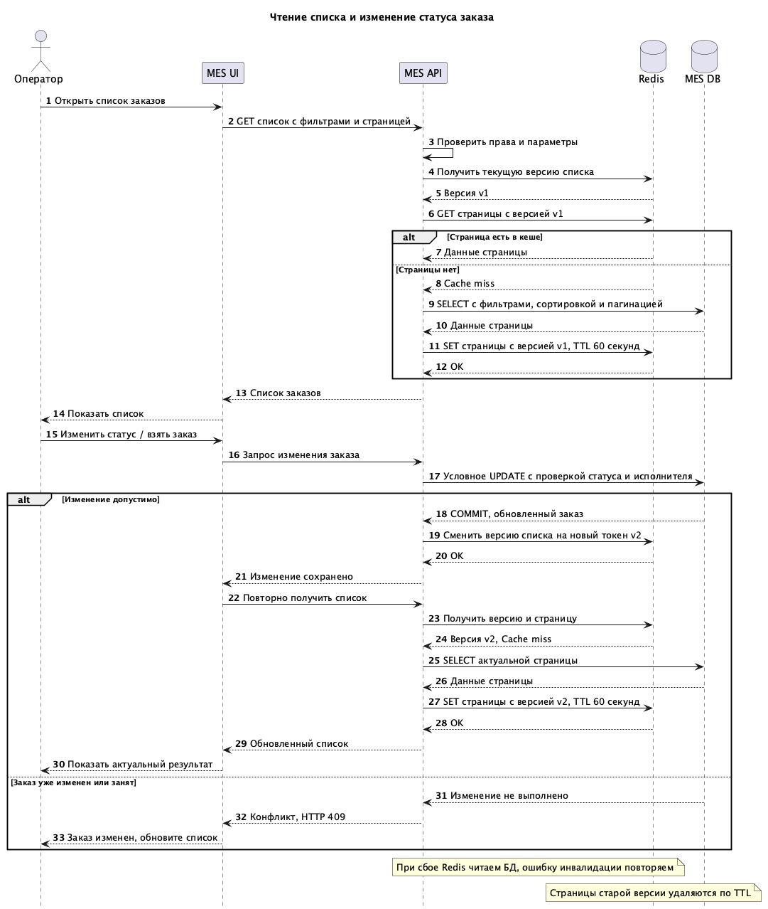

# Задание 5. Архитектурное решение по кешированию

## 1. Мотивация

Операторы жалуются на медленную загрузку списка заказов MES. Фильтрация по статусам и пагинация уже добавлены, но проблему не решили. При этом операторам важно быстро видеть новые заказы и брать их в работу.

Предлагаемое решение: кешировать результаты чтения списка заказов между MES API и MES DB. Повторные запросы одной страницы с одинаковыми параметрами смогут получать готовые данные без выполнения SQL-запроса.

| Что кешируем                                                                                                                         | Какой результат ожидаем                                |
| ------------------------------------------------------------------------------------------------------------------------------------ | ------------------------------------------------------ |
| Страницы списка заказов с фильтрами, сортировкой и пагинацией.                                                                       | Сократить время ответа MES API при повторных запросах. |
| Данные, необходимые для отображения строк списка: номер заказа, статус, время создания, назначенный оператор и другие поля страницы. | Уменьшить количество повторных чтений MES DB.          |

Начать следует с первых страниц типовых списков, которыми чаще всего пользуются операторы. Редкие поисковые запросы и глубокие страницы можно читать напрямую из БД, чтобы не заполнять кеш данными, которые почти не используются.
## 2. Предлагаемое решение

### Вид кеширования и компоненты

**Cерверное кеширование в Redis**. MES API проверяет кеш перед чтением MES DB. Основным источником данных остается PostgreSQL.

| Компонент                    | Что меняется                                                                                     |
| ---------------------------- | ------------------------------------------------------------------------------------------------ |
| MES UI - интерфейс оператора | После успешного изменения статуса повторно запрашивает список.                                   |
| MES API                      | Добавляем чтение и заполнение кеша, инвалидацию после изменений и обработку недоступности Redis. |
| Redis                        | Новый компонент, хранит страницы списка с ограниченным временем жизни.                           |
| MES DB                       | Хранит актуальные заказы, статусы и назначения операторов.                                       |

Общий серверный кеш позволяет использовать результат между пользователями с одинаковым доступом и между экземплярами MES API, если их станет несколько. Ключ страницы включает окружение, версию списка, область доступа пользователя, фильтры, сортировку, номер страницы и ее размер. Параметры приводим к единому виду, чтобы одинаковые запросы использовали один ключ. Если результаты зависят от конкретного оператора, его идентификатор тоже входит в ключ. Проверка прав выполняется до обращения к кешу.

### Выбор паттерна

 **Cache-Aside**: приложение сначала ищет страницу в Redis, а при отсутствии читает БД и сохраняет результат в кеш. После изменения заказа кеш инвалидируется. 

| Паттерн                  | Подходит ли для списка заказов                                                                                                                                                                                 |
| ------------------------ | -------------------------------------------------------------------------------------------------------------------------------------------------------------------------------------------------------------- |
| **Cache-Aside - выбран** | Заполняет кеш только востребованными страницами. Не нужно пересчитывать все комбинации фильтров после каждого изменения. При недоступности Redis можно читать БД.                                              |
| **Write-Through**        | При записи нужно обновлять и хранилище, и кеш. Один заказ влияет на несколько списков и смещает страницы, поэтому поддерживать все варианты дорого и сложно. Увеличится время записи.                          |
| **Refresh-Ahead**        | Заранее обновляет популярные записи до истечения срока. Может быть полезен при стабильном наборе запросов, но требует фонового обновления и все равно не решает изменение статуса сразу после обновления кеша. |

### Инвалидация кеша

**Программная инвалидация после изменения данных и TTL.** Предалагаемый TTL страницы - 60 секунд, дополнительно нужно проверить по нагрузке и допустимой задержке отображения новых заказов. При создании заказа, изменении статуса, назначении оператора или изменении другого поля списка MES API сначала сохраняет данные в БД, а затем меняет общую версию списка в Redis. Это касается и изменений, полученных из CRM через RabbitMQ.

Версию включаем в ключ каждой страницы. После ее смены новые запросы используют другие ключи, а прежние страницы удаляются по TTL:  так не нужно искать и удалять все комбинации фильтров. Версию храним без TTL, при инициализации и каждом изменении используем новый уникальный токен, чтобы случайно не вернуться к старым ключам. Первичное создание версии выполняем атомарно. Если запрос начал чтение БД до изменения заказа, он запишет результат под ранее прочитанной версией. После инвалидации новые запросы эту страницу уже не используют. При этом уже выполняющийся запрос может вернуть старые данные.

| Стратегия                     | Почему выбираем или отклоняем                                                                                                                                                                          |
| ----------------------------- | ------------------------------------------------------------------------------------------------------------------------------------------------------------------------------------------------------ |
| **Смена версии после записи** | Инвалидирует все страницы, которых могло коснуться изменение, включая списки со старым и новым статусом. Проще для первого внедрения, но частые изменения уменьшают число попаданий в кеш. Используем. |
| **Только TTL**                | Прост в реализации, но после каждого изменения список остается старым до истечения срока. Поэтому используем TTL вместе с программной инвалидацией.                                                    |
| **Удаление отдельных ключей** | Подходит для кеша одного заказа. Для списков нужно учитывать фильтры, сортировку и смещение страниц; легко пропустить затронутый ключ. Не используем.                                                  |
| **Полная очистка Redis**      | Удаляет и данные, не связанные со списком заказов, создает лишнюю нагрузку на БД. Не используем.                                                                                                       |

Если обновление версии не удалось, изменение заказа в БД не отменяется. Ошибка фиксируется и повторяется инвалидация. TTL ограничивает жизнь оставшихся страниц. Redis и PostgreSQL не обновляются одной транзакцией, поэтому короткое расхождение возможно.

### Предлагаемый формат ключа.

Ключ текущей версии списка: `{env}:mes:orders:version`. Значение - уникальный токен, который меняется после изменения данных заказа.

Ключ страницы списка: `{env}:mes:orders:{version}:{access_scope}:{filters_hash}:{sort}:{page}:{page_size}`.

- `env` - окружение,
- `version` - текущая версия списка,
- `access_scope` - область доступа; если список персональный - идентификатор оператора,
- `filters_hash` - хеш фильтров, приведенных к единому формату,
- `sort` - поле и направление сортировки,
- `page, page_size` - номер и размер страницы.

### Чтение и изменение статуса

